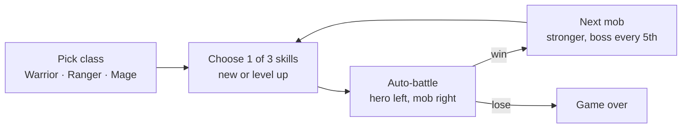
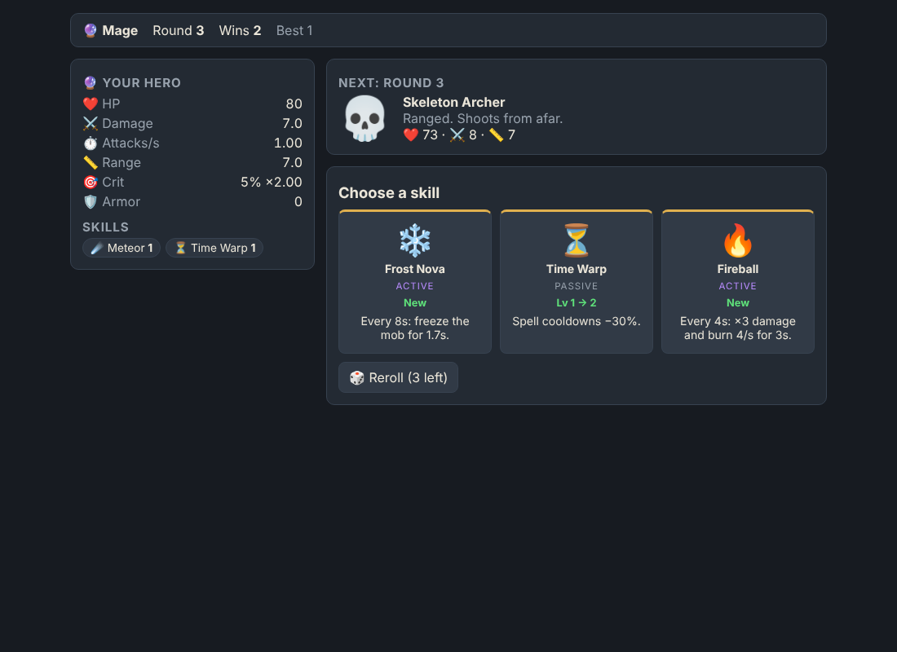
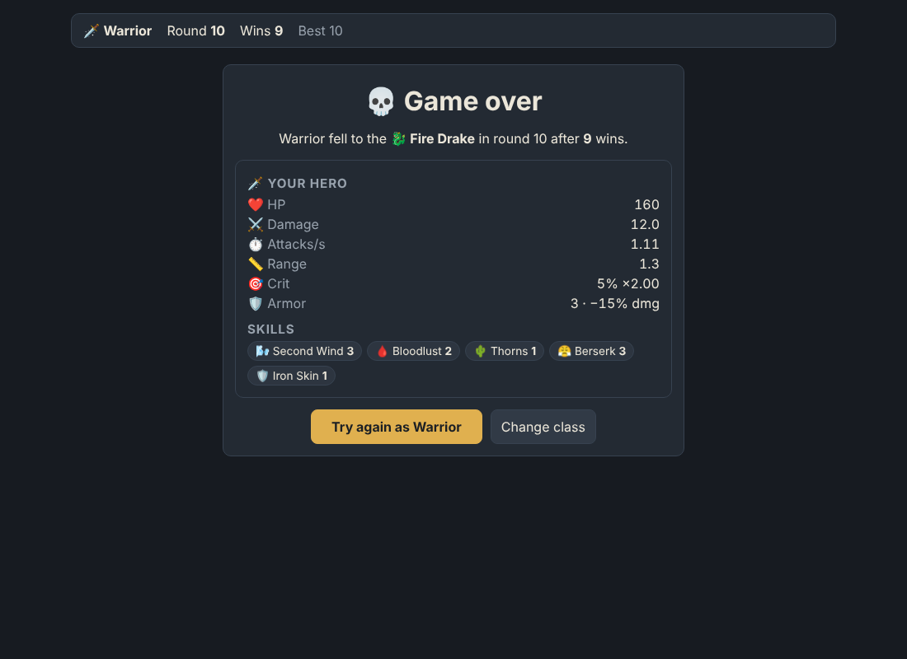

# Fjord Battlegrounds

A browser roguelite auto-battler: pick a class, pick a skill, watch your hero fight a mob, repeat until you fall. TypeScript + Vite, no framework, no backend.

```bash
npm install
npm run dev      # http://localhost:5173
npm test         # run loop, combat, balance
npm run build
```

Live: https://omygod9138.github.io/auto-battler/ (deployed by `.github/workflows/pages.yml` on every push to `main`).

## Loop



| Choose | Battle | Game over |
| --- | --- | --- |
|  |  |  |

## Rules

- **Classes:** Warrior (melee, walks up, tanky), Ranger (ranged, fast arrows), Mage (magic bolts ignore armor and dodge; spells on cooldowns).
- **Skills:** 8 per class + 8 shared, each up to Lv 3. Every offer has at least 2 class skills. 3 rerolls per run. Kinds: *passive* (stats), *on hit* (procs), *active* (auto-cast on cooldown).
- **Mobs:** Slime, Dire Wolf (fast), Skeleton Archer (ranged), Orc Brute (armor), Wraith (dodge, magic), Cave Troll (regen); bosses every 5th round (Draugr Lord, Fire Drake, Frost Jötunn) enrage below half HP. HP ×1.15 and damage ×1.09 per round.
- **Battle:** 20 ticks/s deterministic sim, full heal between rounds, 60 s limit (timeout = loss).

## Code map

- `src/core/` (pure, seeded, no DOM): `stats.ts` classes · `skills.ts` skill table and numbers · `mobs.ts` roster and scaling · `battle.ts` tick sim · `run.ts` choose → battle → next state machine.
- `src/ui/battleView.ts` side-view canvas renderer (projectiles, floating numbers, cooldown HUD).
- `src/main.ts` screens and input.
- `tests/balance.test.ts` keeps random-pick runs at 5–20 wins per class.
