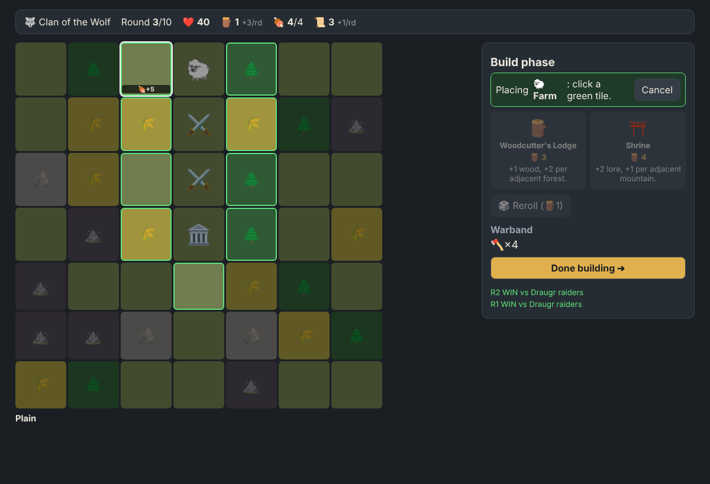
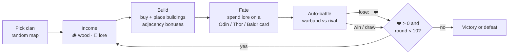
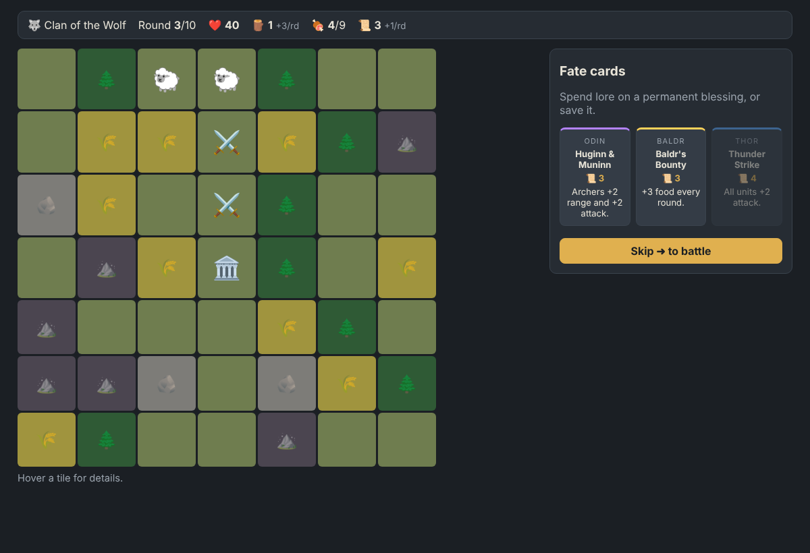
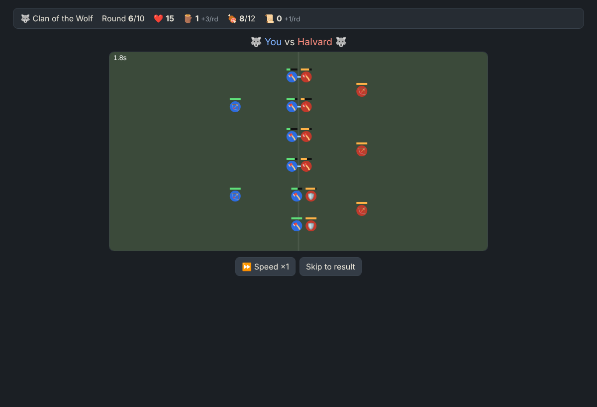

# Fjord Battlegrounds

A browser city-building auto-battler inspired by [Northgard: Battlegrounds](https://store.steampowered.com/app/4487060/Northgard_Battlegrounds/). TypeScript + Vite, no framework, no backend.

```bash
npm install
npm run dev      # http://localhost:5173
npm test         # rules, combat, balance
npm run build
```

Live: https://omygod9138.github.io/auto-battler/ (deployed by `.github/workflows/pages.yml` on every push to `main`).



## Round loop



| Build | Fate | Battle |
| --- | --- | --- |
|  |  |  |

## Rules (MVP)

- **Map:** 7×7 tiles: plain, 🌲 forest, 🌾 fertile, 🪨 stone, ⛰️ mountain (unbuildable). Town hall in the centre; new buildings must touch the settlement.
- **Resources:** 🪵 wood buys buildings. 🍖 food is army supply (units over the cap stay home; oldest barracks fed first). 📜 lore buys fate cards.
- **Buildings:** economy (woodcutter, farm, quarry, shrine), military (barracks, archery range, shield longhouse, troll cave), support auras (forge +atk, healer +HP to adjacent military). Each one's yield depends on its neighbours.
- **Clans:** Stag (+food per farm), Raven (+wood per round), Wolf (+warrior attack).
- **Opponents:** rounds 1–2 are draugr raiders. Later rounds are rival clans: a bot that plays the same rules greedily, or about half the time a 👻 ghost of a warband you fielded in an earlier run (saved in `localStorage`).
- **Damage on loss:** `1 + ceil(round / 2) + min(10, surviving enemy threat)`. Start at 40 ❤️; survive 10 rounds to win.

## Research: what's from the real game vs. our own

Checked against the Steam store text, press coverage and the fan wiki (Oct 2026, before the Oct 27 Early Access launch).

| Mechanic | Source |
| --- | --- |
| Pick a clan (Raven, Stag, Wolf), place town hall, build round by round | Steam / press |
| Placement + adjacency drive economy and unit strength; mythic sites spawn creatures | press, fan wiki |
| Lore spent on fate cards each round; patrons Odin, Thor, Baldr | fan wiki, press |
| Automatic battle at end of each round | Steam / press |
| Asynchronous PvP vs ghosts of other players' settlements, occasional NPC enemies | fan wiki |
| HP numbers, round count, damage formula, every building/unit/card stat | **our own**: not published |

## Code map

- `src/core/` — pure, deterministic game logic (seeded RNG); no DOM.
  - `data.ts` content tables · `board.ts` map, adjacency, income, warband · `combat.ts` tick-based battle sim · `game.ts` run state machine + bot.
- `src/ui/` — canvas battle renderer, ghost store.
- `src/main.ts` — DOM rendering and input.

## Next steps

Real async PvP needs a small backend storing warband snapshots per round (a NestJS endpoint would do); after that: unit tiers/upgrades, more clans and fate cards, hex tiles, sound.
